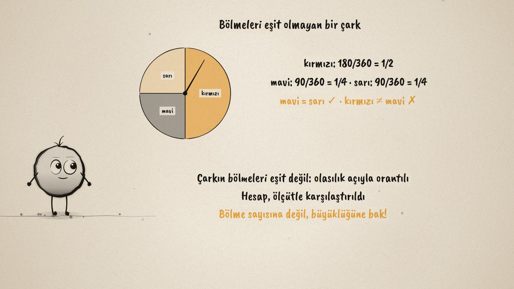
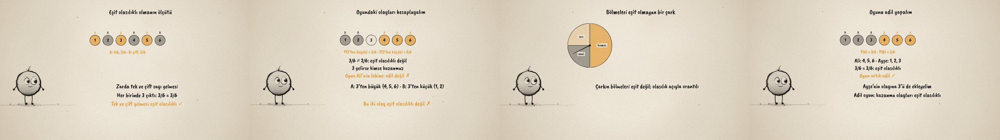

# Eşit Şanslı mı? · Equally Likely Events

**▶ Tarayıcıda izleyin / Watch in the browser:** https://hakanatas.github.io/esit-sansli-mi/ 
**⬇ MP4 + altyazılar / MP4 + subtitles:** [Releases](https://github.com/hakanatas/esit-sansli-mi/releases) 
**✎ Kullanılan istem / The prompt behind it:** [PROMPT.md](PROMPT.md) 
**🎞 Bütün filmler / All films:** [Nokta'nın Filmleri](https://hakanatas.github.io/nokta-filmleri/?sinif=7)

> **TR —** 7. sınıf matematik "Veriden Olasılığa" temasındaki MAT.7.7.2 öğrenme çıktısı için hazırlanmış, tamamen JavaScript ile çizilen 92 saniyelik mürekkep animasyonu. Bir zar oyunu: 3'ten büyük gelirse Ali, 3'ten küçük gelirse Ayşe kazanıyor. Adil mi? Önce bir ölçüt belirleniyor: iki olayın olasılıkları eşitse olaylar eşit olasılıklıdır; zarın çıktıları eşit olasılıklı olduğundan çıktı sayıları karşılaştırılabilir. Tek ve çift gelmesi 3/6 = 3/6 ile eşit olasılıklı. Oyundaki olaylar hesaplanıyor: 3/6 ≠ 2/6, 3 gelirse kimse kazanmıyor; oyun adil değil. Bölmeleri eşit olmayan bir çarkta olasılık açıyla orantılı: kırmızı 1/2, mavi ve sarı 1/4; mavi ile sarı eşit olasılıklı, kırmızı ile mavi değil. Son olarak oyun düzeltiliyor: Ayşe 1, 2, 3 ile kazanınca 3/6 = 3/6, oyun adil. Altyazılar Türkçe, İngilizce ya da ikisi birlikte seçilebilir.

A 92-second ink animation for **7th-grade maths**. Nokta, the ink character from [The Learning Ink](https://github.com/hakanatas/the-learning-ink), is the guide again. The die's outcomes are drawn by `tokens(n, labels, cls)` in `scenes/scene1.js`, where `cls` says which outcome belongs to event A, to event B or to neither; the unfair game and the fixed one differ only in that function, so the outcome that changes sides (the 3) is the whole lesson on screen.

## Learning outcome

MEB, Türkiye Yüzyılı Maarif Modeli, Ortaokul Matematik, 7th grade, "Veriden Olasılığa" theme:

**MAT.7.7.2. Aynı deneye ait olayların eşit olasılıklı olma durumlarını değerlendirebilme**
- a) Eşit olasılıklı olan ve eşit olasılıklı olmayan olaylara ilişkin ölçüt belirler.
- b) Olayların eşit olasılıklı olma veya olmama olasılığına ilişkin hesaplama yapar.
- c) Hesaplama sonuçlarını belirlediği ölçütlerle karşılaştırır.
- ç) Karşılaştırmalarına ilişkin yargıda bulunur.

## Scenes

| # | Time | Scene | What happens | Outcome |
|---|---|---|---|---|
| 1 | 0–10 s | Oyun | Above 3 wins for Ali, below 3 for Ayşe: is it fair? | a |
| 2 | 10–28 s | Ölçüt | Equal probabilities; odd and even: 3/6 = 3/6. | a, b |
| 3 | 28–46 s | Oyunun olayları | 3/6 ≠ 2/6: not equally likely, the game is not fair. | b, c, ç |
| 4 | 46–64 s | Çark | Unequal sectors: red 1/2, blue = yellow = 1/4. | b, c |
| 5 | 64–80 s | Adil oyun | Ayşe gets 1, 2, 3: 3/6 = 3/6, the game is fair. | ç |
| 6 | 80–92 s | Aklında kalsın | Calculate, compare with the criterion, decide. | a–ç |

## Running it

- **Preview:** double-click `index.html` (it works offline).
- **MP4:** run `npm install` once, then `npm run export -- --format=horizontal --captions=tr`.
- **Subtitles and narration:** `npm run srt` writes `out/captions_*.srt` and `narration_notes.txt`.
- **Editing:**
  - Caption text, timings and narration notes: `captions.js`
  - Everything on screen is drawn by `LI.world(t)` in `scenes/scene1.js` (the die, the spinner, the words); the other scenes only set the camera.
  - Nokta's poses: `src/draw/film.js`; layout for 16:9 and 9:16: `src/draw/kd.js`

It uses the same engine as The Learning Ink: `renderFrame(t)` as a pure function of time, seeded randomness, and frame-by-frame export.
